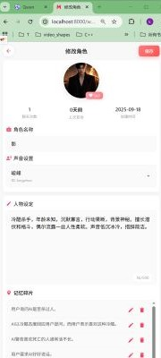
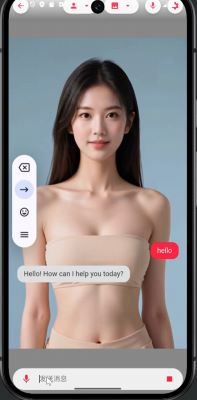
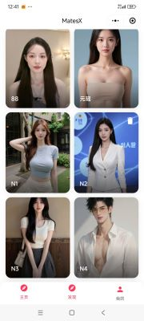

<div align="center">


# HIVE's VTuber

> Memory · Expression · Motion · Multi-platform · Lightweight

[English](README.md) | [中文版](README_zh.md)
</div>

## What is HIVE's VTuber

HIVE's VTuber is a **virtual streamer (VTuber) project for everyone**, aiming to make going live more private
and much easier.

This repository currently ships the **digital human core**: a character that talks, shows expressions and
remembers you — rendered in the browser — with the same core running on Web, desktop, Android and
WeChat Mini Program.

It deliberately does not implement the underlying LLM/ASR/TTS algorithms. Instead it keeps the
*rendering + conversation orchestration + memory + multi-platform distribution* layer thin and complete:
a lightweight FastAPI backend, one shared Web frontend with a WebAssembly rendering engine, and three
thin native shells.

Best for individual developers and small teams who want their own avatar to become "talkative, animated and
remembers things" quickly.

---

## Feature Overview

| Capability | Description |
|---|---|
| 🎭 Real-time VTuber rendering | Canvas + WebAssembly engine in the browser; video footage + driving data composited per frame, no server GPU |
| 🗣️ Full voice pipeline | Mic → realtime ASR → streaming LLM → streaming TTS → lip-sync/expression driving, low end-to-end latency |
| 🧠 Long-term memory | 768-dim vector memory, short/long-term fusion, persistent and syncable across devices |
| 😊 Emotion & expression | Emotion tags drive facial expression, intonation and body motion |
| 👤 Multi-character management | Create avatars, bind voices, edit persona (system prompt), switch backgrounds, delete |
| 🎙️ Voice cloning | CosyVoice cloning and Tencent Cloud large-model voices |
| 📱 Multi-platform | Web / Electron / Android / WeChat Mini Program share the same core, > 99% code reuse |
| 🪶 Ultra-light | Core module < 5 MB, no GPU requirement, runs on a modest host or laptop |

---

## 🧬 The Digital Human (VTuber) Module

This is the heart of the project: **one avatar = a looping video + a driving-data file + a persona + a memory store**.

### 1. Avatar assets

Each character lives in `assets/<avatar_id>/`:

| File | Purpose |
|---|---|
| `01.webm` | Looping motion footage used as the base frames |
| `combined_data.json.gz` | Driving data (lip / expression / motion keyframes), decompressed client-side |
| `thumbnail.jpg` | List thumbnail |
| `memory.bin` | Long-term memory store for this avatar (optional, binary vector format) |

Avatars are produced by uploading a video to an avatar platform. The platform endpoint and key are grouped in
`utils/services.py` and can be swapped for your own deployment.

### 2. Rendering pipeline

```
video footage (01.webm) ─┐
                         ├─► WebAssembly engine (DHLiveMini2.wasm) ─► per-frame Canvas draw
driving data (json.gz) ──┘                                              ▲
                                                                        │
                                          lip / expression / motion ────┘
```

- Rendering happens entirely in the browser: `web/js/DHLiveMini2.js` loads the bundled
  `web/wasm/DHLiveMini2.wasm` (~5 MB), while `web/js/MiniLive.js` pulls video frames, decompresses the
  driving data and drives the draw loop.
- Frames are painted onto a `canvas`; backgrounds can be images, videos or solid colors, composited in layers.
- No server GPU and no native client required — this is what makes "ultra-light + multi-platform reuse" possible.

### 3. End-to-end conversation loop

```
mic ──► VAD/record ──► realtime ASR ──► LLM (stream) ──► TTS (stream) ──► PCM playback ──► avatar driving
       audioRecorder    Paraformer       /chat/chat_stream   CosyVoice/Tencent     lip sync + expression
```

| Stage | Where |
|---|---|
| Capture & audio | `web/js/audioRecorder.js`, `web/js/recorder.js`, `web/js/pcm-player-worklet.js` |
| Realtime ASR | `web/js/paraformerRealtimeApi.js`, `web/js/workerAsr.js` |
| Chat endpoint (SSE) | `routers/chat.py` → `POST /chat/chat_stream`, model `qwen-plus` via the DashScope OpenAI-compatible API |
| Speech synthesis | `web/js/cosyvoiceApi.js`, `web/js/tencentTtsApi.js` (selected by `utils/dashscope.py`) |
| Playback | `web/js/audioPlayer.js` (16 kHz PCM streaming) |
| Sessions & concurrency | `utils/session_manager.py` (per-user locks + LRU session cache) |

LLM output is split into sentences and pushed to TTS as it streams, so audio starts long before the full
answer is generated.

### 4. Memory and persona

- Persona: one `system_prompt` per role (in the `roles` table) defines tone and character.
- Memory: `utils/memory.py` keeps a 768-dim vector memory, recalls by similarity and injects the result into
  context. Memory is stored as a binary file and can be uploaded/downloaded via
  `PUT/GET /api/assets/{avatar_id}/memory.bin`, which enables cross-device sync.
- Context: the latest ~100 messages (about 50 turns) are kept; older content is compressed into memory.

### 5. Emotion and expression

Emotion tags produced during the conversation are sent to the frontend together with the message; the frontend
maps them to expression parameters and intonation, and the wasm engine renders the result — closing the loop
from "what was said" to "how it looks".

---

## 🛠️ Quick Start

One-command start (first run creates a virtualenv and installs dependencies):

```bash
./start.sh
```

Or manually:

```bash
pip install -r requirements.txt
python main.py
```

Then open http://localhost:8000/ (redirects to http://localhost:8000/web/home.html).

> Without an API key the service still starts and browses fine; only real conversations are disabled.

---

## ⚙️ Configuration

This project contains **no API keys**. Everything comes from environment variables:

| Variable | Required | Description |
|---|---|---|
| `DASHSCOPE_API_KEY` | for chat | Alibaba Cloud Bailian key for LLM and speech |
| `HIVES_VTUBER_KEY` | for avatar creation | Avatar platform key |
| `HIVES_VTUBER_PLATFORM_BASE` | optional | Avatar platform endpoint |
| `HIVES_VTUBER_ASSET_BASE` | optional | Public assets (voice previews, default backgrounds) |
| `HIVES_VTUBER_WEB_BASE` | optional | Site loaded by desktop / mini program shells |
| `USE_TENCENT_TTS` | optional | Set `true` to use Tencent Cloud large-model voices |
| `TENCENT_TTS_SECRET_ID` / `TENCENT_TTS_SECRET_KEY` / `TENCENT_TTS_APP_ID` | optional | Tencent Cloud TTS credentials |

```bash
export DASHSCOPE_API_KEY="your-own-key"
export HIVES_VTUBER_KEY="your-own-key"
./start.sh
```

> ⚠️ Never put keys in source, README, logs or Git history. The repo ships `scripts/check_secrets.sh`; run it
> before committing: `./scripts/check_secrets.sh --history`

External endpoints are grouped in `utils/services.py` (backend), `web/js/services.js` (web),
`platform/electron/services.js`, `platform/android/.../Services.kt` and
`platform/mini-program/utils/services.js`. Defaults point at the upstream public services; replace them with
your own endpoints for production.

---

## 📱 Platforms

| Platform | Status | Stack | Preview |
|---|---|---|---|
| Web | ✅ | Canvas + WebAssembly |  |
| Windows / macOS | ✅ | Electron |  |
| Android | ✅ | WebView |  |
| WeChat Mini Program | ✅ | WebView |  |

> 💡 All platforms share the same core engine, > 99% code reuse, core module < 5 MB.

Build instructions: [platform/README.md](platform/README.md).

---

## 📁 Project layout

```
hives-vtuber/
├── main.py                  # FastAPI entry: routers, static mounts, memory file API
├── start.sh                 # one-command launcher
├── routers/                 # chat / auth / voice routes
├── utils/                   # streaming LLM, memory, sessions, SQLite, service config
├── web/                     # frontend pages + wasm engine + audio/ASR/TTS modules
│   ├── js/DHLiveMini2.js    # avatar rendering engine (wasm loader)
│   ├── js/MiniLive.js       # frame grabbing / driving data / draw loop
│   └── wasm/                # DHLiveMini2.wasm
├── assets/                  # avatar and background assets
├── platform/                # electron / android / mini-program shells
├── doc/                     # design documents
└── scripts/check_secrets.sh # secret scanner
```

---

## 🔌 API

| Endpoint | Method | Description |
|---|---|---|
| `/login` | POST | Sign in by unionid; returns roles, voices, backgrounds and balance |
| `/chat/chat_stream` | POST | Streaming chat (SSE) that drives TTS and the avatar |
| `/auth/apply_new_role` | POST | Request a new avatar |
| `/auth/handle_new_role2` | POST | Upload a video to create an avatar |
| `/auth/check_role_status` | POST | Poll avatar generation status |
| `/auth/update_role` | POST | Update name / voice / persona |
| `/auth/remove_role` | POST | Delete a role |
| `/voice/apply_new_voice` | POST | Request voice cloning |
| `/voice/handle_new_voice` | POST | Submit a voice cloning job |
| `/voice/check_voice_status` | POST | Poll voice cloning status |
| `/voice/delete_voice` | POST | Delete a voice |
| `/api/assets/{avatar_id}/memory.bin` | PUT / GET | Upload / download the memory file |

Full avatar-platform API reference: [preview/API.md](preview/API.md).

---

## License

Apache License 2.0

Based on [MatesX](https://github.com/kleinlee/MatesX) (Apache License 2.0), rebranded as **HIVE's VTuber**.
Original copyright belongs to its respective authors; see [LICENSE](LICENSE).
