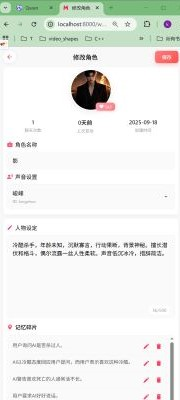
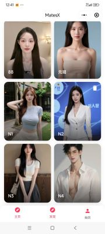

<div align="center">


# HIVE's VTuber

> 记忆 · 表情 · 动作 · 多端 · 轻量

[English](README.md) | [中文版](README_zh.md)
</div>

## 项目简介

HIVE's VTuber 是一个**面向各类人群的虚拟主播（VTuber）项目**，目标是让开播更有隐私、更加轻松。

本仓库当前提供的是其中的**数字人核心能力**：在浏览器里渲染会说话、有表情、有记忆的数字人角色，
并把它同时跑在 Web、桌面端、Android 和小程序上。

它不做底层大模型和语音算法，而是把「数字人渲染 + 对话编排 + 记忆管理 + 多端分发」这一层做薄、做完整：
后端是一个轻量 FastAPI 服务，前端是一套共享的 Web 页面 + WebAssembly 渲染引擎，三端外壳只负责套壳加载。

适合：想快速给自有形象接上「能聊、会动、记得住」能力的个人开发者与小型团队。

---

## 功能简介

| 能力 | 说明 |
|---|---|
| 🎭 数字人实时渲染 | 浏览器端 Canvas + WebAssembly 引擎，视频素材 + 驱动数据实时合成，无需服务端 GPU |
| 🗣️ 全链路语音对话 | 录音 → 实时 ASR → 大模型流式回复 → TTS 流式合成 → 口型/表情驱动，端到端低延迟 |
| 🧠 长期记忆 | 768 维向量记忆库，长短期记忆融合，支持记忆持久化与跨设备同步 |
| 😊 情感与表情 | 由对话内容与情绪标签驱动表情、语调和肢体动作 |
| 👤 多角色管理 | 形象创建、绑定音色、人物设定（system prompt）、背景切换、删除 |
| 🎙️ 音色克隆 | 支持 CosyVoice 音色克隆与腾讯云大模型音色 |
| 📱 多端共用 | Web / Electron / Android / 微信小程序共享同一套核心代码，复用率 > 99% |
| 🪶 极轻量 | 核心模块 < 5 MB，无 GPU 依赖，可跑在普通云主机或本地 |

---

## 🧬 数字人（VTuber）模块

这是本项目的核心部分：**一个形象 = 一段循环视频 + 一份驱动数据 + 一个设定 + 一份记忆**。

### 1. 数字人形象资产

每个数字人角色存放在 `assets/<avatar_id>/` 下：

| 文件 | 作用 |
|---|---|
| `01.webm` | 角色循环动作视频（底片），渲染时逐帧取用 |
| `combined_data.json.gz` | 驱动数据（口型 / 表情 / 动作关键帧），前端解压后交给 wasm 引擎 |
| `thumbnail.jpg` | 列表页缩略图 |
| `memory.bin` | 该角色的长期记忆库（可选，二进制向量格式） |

形象通过「形象平台」上传视频后生成，平台地址与密钥集中在 `utils/services.py`，可替换为自己部署的服务。

### 2. 渲染与驱动流程

```
视频底片 (01.webm)  ─┐
                    ├─► WebAssembly 渲染引擎 (DHLiveMini2.wasm) ─► Canvas 逐帧绘制
驱动数据 (json.gz) ─┘                                              ▲
                                                                  │
                                       口型 / 表情 / 动作参数 ──────┘
```

- 渲染完全发生在浏览器：`web/js/DHLiveMini2.js` 加载内置的 `web/wasm/DHLiveMini2.wasm`（约 5 MB），
  `web/js/MiniLive.js` 负责取视频帧、解压驱动数据、调度绘制循环。
- 视频帧通过 `canvas` 输出，背景支持静态图、视频与纯色，前后景分层合成。
- 不依赖服务端 GPU，也不依赖原生客户端，这是「超轻量 + 多端复用」的关键。

### 3. 对话闭环（端到端）

```
麦克风 ──► VAD/录音 ──► 实时 ASR ──► LLM（流式） ──► TTS（流式） ──► PCM 播放 ──► 数字人驱动
          audioRecorder   Paraformer    /chat/chat_stream   CosyVoice/腾讯云     口型+表情
```

| 环节 | 实现位置 |
|---|---|
| 录音与音频采集 | `web/js/audioRecorder.js`、`web/js/recorder.js`、`web/js/pcm-player-worklet.js` |
| 实时语音识别 | `web/js/paraformerRealtimeApi.js`、`web/js/workerAsr.js` |
| 对话接口（SSE 流式） | `routers/chat.py` → `POST /chat/chat_stream`，模型 `qwen-plus`（DashScope OpenAI 兼容接口） |
| 语音合成 | `web/js/cosyvoiceApi.js`、`web/js/tencentTtsApi.js`（由 `utils/dashscope.py` 的配置决定用哪一家） |
| 音频播放 | `web/js/audioPlayer.js`（16k PCM 流式播放） |
| 会话与并发控制 | `utils/session_manager.py`（用户级锁 + LRU 会话缓存） |

大模型返回的文本按句切分后立即送往 TTS，边合成边播放，因此首字延迟远低于「等全文生成再合成」。

### 4. 记忆与人格设定

- 人格：每个角色一句 `system_prompt`（`roles` 表），决定说话风格与人设。
- 记忆：`utils/memory.py` 维护 768 维向量记忆，按相似度召回后拼进上下文；
  记忆以二进制文件保存，可通过 `PUT/GET /api/assets/{avatar_id}/memory.bin` 上传下载，实现跨设备同步。
- 上下文：保留最近 100 条消息（约 50 轮），超出后交由记忆库压缩承接。

### 5. 情感与表情

对话过程中产生的情绪标签会随消息下发给前端，前端据此选择表情参数与语调，再由 wasm 引擎渲染到画面上，
形成「说了什么 → 什么情绪 → 什么表情」的闭环。

---

## 🛠️ 快速开始

一键启动（首次运行自动创建虚拟环境并安装依赖）：

```bash
./start.sh
```

或手动执行：

```bash
pip install -r requirements.txt
python main.py
```

然后打开 http://localhost:8000/ （自动跳转到 http://localhost:8000/web/home.html）。

> 未配置 API Key 时服务仍可正常启动与浏览，只是无法进行真实对话。

---

## ⚙️ 配置

本项目**不包含任何 API Key**，全部通过环境变量提供：

| 环境变量 | 是否必填 | 说明 |
|---|---|---|
| `DASHSCOPE_API_KEY` | 对话必填 | 阿里云百炼 API Key，用于 LLM 与语音 |
| `HIVES_VTUBER_KEY` | 创建形象必填 | 形象平台密钥 |
| `HIVES_VTUBER_PLATFORM_BASE` | 可选 | 形象平台地址 |
| `HIVES_VTUBER_ASSET_BASE` | 可选 | 公共素材（语音试听、默认背景）地址 |
| `HIVES_VTUBER_WEB_BASE` | 可选 | 桌面端 / 小程序内嵌的站点地址 |
| `USE_TENCENT_TTS` | 可选 | 设为 `true` 时使用腾讯云大模型音色 |
| `TENCENT_TTS_SECRET_ID` / `TENCENT_TTS_SECRET_KEY` / `TENCENT_TTS_APP_ID` | 可选 | 腾讯云 TTS 凭据 |

```bash
export DASHSCOPE_API_KEY="your-own-key"
export HIVES_VTUBER_KEY="your-own-key"
./start.sh
```

> ⚠️ 请不要把 Key 写进源码、README、日志或提交到 Git。仓库内置 `scripts/check_secrets.sh` 用于提交前扫描：
> `./scripts/check_secrets.sh --history`

外部服务地址集中在 `utils/services.py`（后端）、`web/js/services.js`（Web 端）、
`platform/electron/services.js`、`platform/android/.../Services.kt`、`platform/mini-program/utils/services.js`，
默认值指向上游公网服务，正式部署时替换为你自己的地址。

---

## 📱 多端支持

| 平台 | 状态 | 技术路线 | 预览 |
|---|---|---|---|
| Web | ✅ | Canvas + WebAssembly |  |
| Windows / macOS | ✅ | Electron |  |
| Android | ✅ | WebView |  |
| 微信小程序 | ✅ | WebView |  |

> 💡 所有平台共享同一套核心引擎，代码复用率 > 99%，核心模块 < 5MB。

编译方式见 [platform/README.md](platform/README.md)。

---

## 📁 目录结构

```
hives-vtuber/
├── main.py                  # FastAPI 入口：路由挂载、静态资源、记忆文件接口
├── start.sh                 # 一键启动
├── routers/                 # chat / auth / voice 三组接口
├── utils/                   # LLM 流式、记忆、会话、SQLite、外部服务配置
├── web/                     # 前端页面 + wasm 渲染引擎 + 音频/ASR/TTS 模块
│   ├── js/DHLiveMini2.js    # 数字人渲染引擎（wasm 加载器）
│   ├── js/MiniLive.js       # 视频取帧 / 驱动数据 / 绘制调度
│   └── wasm/                # DHLiveMini2.wasm
├── assets/                  # 数字人形象与背景素材
├── platform/                # electron / android / mini-program 外壳
├── doc/                     # 设计文档
└── scripts/check_secrets.sh # 密钥扫描
```

---

## 🔌 接口一览

| 接口 | 方法 | 说明 |
|---|---|---|
| `/login` | POST | 按 unionid 登录，返回角色、音色、背景与余额 |
| `/chat/chat_stream` | POST | 流式对话（SSE），驱动 TTS 与数字人 |
| `/auth/apply_new_role` | POST | 申请创建新形象 |
| `/auth/handle_new_role2` | POST | 上传视频创建形象 |
| `/auth/check_role_status` | POST | 查询形象生成状态 |
| `/auth/update_role` | POST | 修改角色名称 / 音色 / 人设 |
| `/auth/remove_role` | POST | 删除角色 |
| `/voice/apply_new_voice` | POST | 申请音色克隆 |
| `/voice/handle_new_voice` | POST | 提交音色克隆任务 |
| `/voice/check_voice_status` | POST | 查询音色克隆状态 |
| `/voice/delete_voice` | POST | 删除音色 |
| `/api/assets/{avatar_id}/memory.bin` | PUT / GET | 上传 / 下载记忆文件 |

完整的形象平台 API 说明见 [preview/API.md](preview/API.md)。

---

## License

Apache License 2.0

本项目基于 [MatesX](https://github.com/kleinlee/MatesX)（Apache License 2.0）重构并更名为 **HIVE's VTuber**，
原始版权归原作者所有，详见 [LICENSE](LICENSE)。
